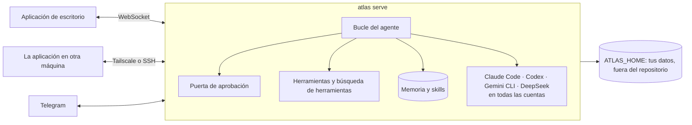

<p align="center">
  <picture>
    <source media="(prefers-color-scheme: dark)" srcset="docs/assets/logo-dark.png">
    
  </picture>
</p>

<h1 align="center">Atlas</h1>

<p align="center">
  <strong>Tu agente personal, y una sola aplicación para todos los agentes de código que usas:<br>
  Claude Code, Codex, Gemini CLI y DeepSeek, en todas tus cuentas, en todas tus máquinas.</strong>
</p>

<p align="center">
  <a href="https://github.com/marqueskaio/atlas/actions/workflows/ci.yml"></a>
  <a href="LICENSE"></a>
  
  
</p>

<p align="center">
  <a href="README.md">English</a> · <a href="README.pt-BR.md">Português</a> · <b>Español</b> · <a href="README.zh-CN.md">中文</a>
</p>

---

Atlas es un agente personal de código abierto, con una aplicación de escritorio. Pon una clave de
API y tienes un asistente que guarda una memoria que puedes leer, escribe sus propias skills a
medida que aprende cómo trabajas, ejecuta rutinas programadas y habla contigo por Telegram.

Y es donde viven tus agentes de código. Ejecuta Claude Code en tu cuenta personal y Codex en la de
tu empresa, uno al lado del otro. Cuando uno llega al límite de su plan, la sesión sigue en la
siguiente cuenta, o en otro harness, sin perder el hilo. Abre el Atlas de tu home lab, de tu VPS o
del PC de la oficina desde la misma ventana. Todo lo que sabe de ti queda en una carpeta tuya.

## Todos los agentes de código, todas las cuentas, una sola aplicación

Claude Code, Codex, Gemini CLI y el harness de DeepSeek son **ejecutores**: Atlas ejecuta la copia
que instalaste, con tus ajustes, las instrucciones de tu proyecto y tu propio inicio de sesión, y
muestra todas sus sesiones, empezaran donde empezaran.

- **Varias cuentas a la vez.** Personal, empresa A, empresa B: cada cuenta en su propia carpeta,
  con sus ajustes, servidores MCP, plugins e historial, para que el trabajo nunca se mezcle. Todas
  funcionan al mismo tiempo, y cada carpeta de proyecto empieza en la cuenta que elegiste para ella.
- **Cambia de cuenta a mitad de conversación.** ¿Sin crédito en una? La sesión sigue en otra cuenta
  con todo lo que tenía.
- **Llegaste al límite, sigue adelante.** Cuando una cuenta llega al límite de su plan, la
  siguiente con sesión iniciada toma el relevo, en el orden que definas. Activado por defecto.
- **Una ruta para cada sesión.** Elige qué cuentas y harnesses puede usar una sesión y en qué
  orden, mezclando harnesses:

  ```
  Claude Code · personal  →  Claude Code · empresa  →  Codex · principal
  ```

  Dentro de un mismo harness, la propia sesión cambia de cuenta. Entre harnesses, el siguiente
  empieza con un traspaso: la tarea, la última instrucción, los pasos pendientes, los archivos
  cambiados y lo que pasó hasta ahí, armado sin ninguna llamada a un modelo.
- **Ve el uso de cada plan.** La ventana de cinco horas, la semana, la cuota de cada modelo, de
  todas tus cuentas, como lo muestra el propio `/usage` del harness, leído sin gastar un token.
- **Retoma cualquier sesión.** La que empezaste en una terminal o en tu editor aparece en la lista.
  Si sigue abierta allí, Atlas te avisa y te ofrece continuar en una copia.
- **Nada se pierde.** Un permiso o una pregunta de un ejecutor te espera sin plazo, en la
  aplicación o en el móvil por Telegram. O deja que Atlas responda: su revisor de seguridad se
  ocupa de los permisos y el modelo de la conversación de las preguntas, y lo que no tenga claro te
  sigue llegando a ti.
- **Atlas también les pasa trabajo.** Pídelo con palabras y Atlas delega en el ejecutor adecuado,
  en la cuenta que digas, con una ruta propia (`claude-code@empresa`, luego `codex`), lo sigue y te
  trae el resultado.

## Todas las máquinas, una sola aplicación

Instala Atlas en el PC de la oficina, en un home lab o en el VPS de tu empresa, y ábrelo desde la
aplicación de tu portátil. El Atlas de allí hace el trabajo, con los archivos, las claves y las
aprobaciones de esa máquina; la aplicación es solo la ventana.

- **Tailscale o SSH.** Pega un código de conexión por Tailscale, sin puertos que abrir ni
  certificados que configurar, o llega a un servidor por un túnel SSH con las claves que ya tienes.
- **Siempre encendido.** Una casa puede funcionar como un servicio que arranca con el ordenador,
  así que las rutinas se ejecutan con la aplicación cerrada y cada ventana ve las mismas
  conversaciones.
- **Una terminal en cada máquina**, en el panel lateral, esté donde esté la aplicación.
- **Casas separadas** mantienen aparte el trabajo y la vida personal en la misma máquina, cada una
  con su memoria, sus claves y sus conversaciones.

## Por qué Atlas

- **El harness es ligero; el que trabaja es el modelo.** Atlas mejora cada vez que mejoran los
  modelos. Mantiene pocas herramientas siempre activas y encuentra el resto por búsqueda, así que
  cada llamada al modelo es pequeña y enfocada.
- **La memoria es texto plano.** Tu perfil y las notas del agente son archivos que puedes abrir,
  editar y versionar. Ninguna base vectorial oculta decidiendo lo que dijiste.
- **Seguro por diseño.** Cada comando pasa por una puerta de aprobación. Algunas cosas nunca se
  ejecutan, en ningún modo. Todo lo que sale de tu máquina en tu nombre, como fusionar un pull
  request o enviar un correo, siempre pregunta antes.
- **Tuyo.** Sin cuenta, sin telemetría, sin nube nuestra. Usa el proveedor de modelos que
  prefieras, y el inicio de sesión de tus propios agentes de código, que Atlas nunca toca.

## Mejora mientras trabajas

Cada pocos mensajes, una copia del agente relee la conversación en segundo plano y guarda lo que
enseñó, para que nunca tengas que corregir lo mismo dos veces:

- **Quién eres** va a tu perfil, y **los datos de tu entorno** (manías de herramientas, rutas,
  convenciones) a las notas del agente.
- **Cómo se hace un tipo de tarea** se convierte en una skill. Cuando corriges su estilo o su
  forma de trabajar, cuando aparece un arreglo o un atajo, o cuando una skill resulta equivocada,
  ajusta la skill que lo cubre, y solo crea una nueva cuando ninguna lo hace.
- **Ignora el ruido:** un programa que faltaba, una tarea puntual, un error que desapareció solo.

No puede romper nada a escondidas. Los datos nuevos se aplican al momento, pero todo lo que
reemplazaría o borraría un recuerdo espera como propuesta hasta que lo apruebes. Nunca borra una
skill, cada cambio guarda la versión anterior (`atlas skills revert` la recupera), y las skills que
creó y llevan 30 días sin usarse se archivan, nunca las tuyas.

## Qué hace

| | |
|---|---|
| 🧠 **Memoria que puedes leer** | Un perfil tuyo y las notas del propio agente, guardados como texto dentro de un límite fijo. Ábrelos, edítalos o pregúntale a Atlas qué sabe. |
| 🛠️ **Skills que escribe él mismo** | Cuando Atlas aprende cómo se hace algo, guarda una skill, con versiones y deshacer. Incluye skills para GitHub, Gmail y Google Calendar. |
| 🤝 **Ejecutores y subagentes** | Claude Code, Codex, Gemini CLI y DeepSeek en todas tus cuentas, con rutas y cambio automático de cuenta. Los subagentes reparten trabajos grandes en paralelo. |
| ⏰ **Rutinas** | Prompts y comandos programados, escritos en palabras ("every weekday at 9") o en cron. |
| 🤖 **Bots** | Agentes con nombre, cada uno con su misión, memoria, skills y rutinas, junto al principal. Se escriben entre ellos. |
| 📱 **Telegram** | Habla con Atlas desde el móvil, y responde desde allí a tus ejecutores. Solo entran las personas que emparejes. |
| 🎙️ **Voz** | Envía audio y Atlas lo lee, dicta en la caja, recibe respuestas en audio cuando lo pidas, o habla en directo. Un plugin oficial, con tu clave de OpenAI. |
| 🌐 **Un navegador propio** | Atlas maneja su propio Chrome, y puedes tomar el control en cualquier momento. |
| 🖥️ **Terminal y vistas previas** | Un panel lateral con una terminal en la máquina donde corre Atlas, y vistas previas de archivos, páginas locales y lo que construye el agente. |
| 🔐 **Puerta de aprobación y bóveda** | Los comandos peligrosos preguntan, los peores nunca se ejecutan, un modelo revisor lee los comandos marcados y un modo automático te deja ceder el volante. Las claves de API viven en una bóveda cifrada. |
| 🧩 **Plugins** | Añade skills, comandos, agentes, hooks, monitores, servidores MCP, herramientas, canales y ejecutores. Los hooks usan los eventos y el JSON de Claude Code. |
| 🌍 **Varias máquinas, varias casas** | Una sola aplicación llega a Atlas en tus otros ordenadores por Tailscale o SSH. Casas separadas mantienen aparte el trabajo y la vida personal. |
| 📦 **Copias de seguridad y gasto** | Un zip con tus datos (nunca la bóveda) y una restauración que lo comprueba antes. Gasto por día, modelo y propósito. |

## Instalación

**Windows**, en PowerShell:

```powershell
irm https://atlasv4.com/install.ps1 | iex
```

**macOS y Linux**, en una terminal:

```bash
curl -fsSL https://atlasv4.com/install.sh | bash
```

El instalador trae todo lo que Atlas necesita (su propio Python, Node y herramientas, comprobados
contra hashes fijados), compila la aplicación de escritorio y la abre. La aplicación pide la clave
de API de un proveedor de modelos, y ya estás hablando con Atlas. Activa Claude Code, Codex, Gemini
CLI o el harness de DeepSeek en Plugins, dentro de los Ajustes, y cada uno que tengas instalado
aparece en la pestaña Ejecutores. Para actualizar, ejecuta la misma línea otra vez; `atlas update`
también lo hace, y vuelve a donde estaba si algún paso falla.

**En un contenedor:** el principio de [docker-compose.yml](docker-compose.yml) tiene los tres
comandos: arrancarlo, guardar una clave de API y obtener el token que necesita la aplicación.

### Proveedores de modelos

OpenAI, Anthropic, Google Gemini y OpenRouter con clave de API, y modelos locales con Ollama o
vLLM. Cada conversación puede cambiar de modelo.

## Cómo funciona



Atlas tiene su propio bucle de agente, sin ningún framework de agentes debajo: habla con el SDK
oficial de cada proveedor. El servidor es la única fuente de verdad, y la aplicación de escritorio,
Telegram y las otras máquinas son sus clientes. Todo lo tuyo (perfil, memoria, conversaciones,
ajustes, bóveda) vive en `ATLAS_HOME`, nunca en el código. Las cuentas de tus ejecutores quedan en
sus propias carpetas, con la sesión iniciada por el propio harness.

## Documentación

Los documentos están en inglés. La documentación está en [src/atlas/docs/pages/](src/atlas/docs/pages/), y cada Atlas instalado lee
la de su versión con `atlas docs`: el propio Atlas también la lee allí antes de responder una
pregunta sobre sí mismo.

- [Qué es Atlas](src/atlas/docs/pages/index.md) y [cómo instalarlo](src/atlas/docs/pages/install.md)
- [Agentes de código y cuentas](src/atlas/docs/pages/guides/coding-agents.md) y [varias máquinas](src/atlas/docs/pages/guides/machines.md)
- [Memoria](src/atlas/docs/pages/guides/memory.md): qué recuerda Atlas, cómo, y cómo cambiarlo
- [Revisión en segundo plano](src/atlas/docs/pages/guides/background-review.md): cómo aprende Atlas de una conversación
- [Bots](src/atlas/docs/pages/guides/bots.md): crear un bot y hablar con él
- [La puerta de aprobación](src/atlas/docs/pages/guides/approval-gate.md): qué pregunta, qué nunca se ejecuta, y el modo automático
- [Comandos](src/atlas/docs/pages/reference/commands.md), [ajustes](src/atlas/docs/pages/reference/settings.md) y [herramientas](src/atlas/docs/pages/reference/tools.md): la referencia, los dos primeros escritos a partir del código
- [Plugins](src/atlas/docs/pages/extending/plugins.md): escribir un plugin

Para quien trabaja en el código:

- [Arquitectura](docs/ARCHITECTURE.md): las decisiones y las reglas que sigue el código
- [Glosario](docs/GLOSSARY.md): las palabras que usa Atlas

## Estado

Atlas es joven y avanza rápido. Se usa a diario, y una gran batería de pruebas corre en cada cambio:
pruebas unitarias, la aplicación de escritorio real de punta a punta, los instaladores en Windows y
Linux, y la imagen del contenedor. Espera asperezas y cambios entre versiones. El plan está en
[ROADMAP.md](ROADMAP.md) (en portugués).

## Contribuir

Los issues y pull requests son bienvenidos. Lee [AGENTS.md](AGENTS.md) para saber cómo trabajar en
el código, y [docs/ARCHITECTURE.md](docs/ARCHITECTURE.md) antes de escribir nada: el CI hace cumplir
sus reglas.

```bash
uv sync                 # instala (uv gestiona Python 3.13)
uv run pytest           # pruebas
uv run atlas serve      # el servidor, en 127.0.0.1:18790
cd apps/desktop && npm ci && npm run dev   # la aplicación, desde el código
```

## Licencia

[MIT](LICENSE). Algunos archivos contienen reglas y casos de prueba de otros proyectos MIT; cada uno
lo dice en su propia cabecera, y el texto de la licencia está en [LICENSES/](LICENSES/).
