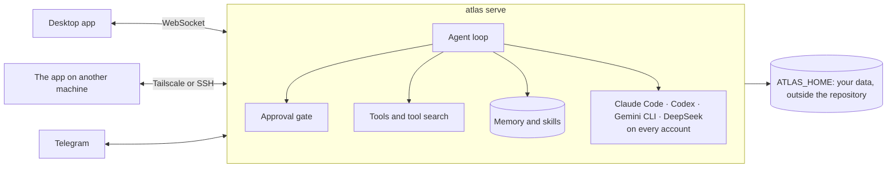

<p align="center">
  <picture>
    <source media="(prefers-color-scheme: dark)" srcset="docs/assets/logo-dark.png">
    
  </picture>
</p>

<h1 align="center">Atlas</h1>

<p align="center">
  <strong>Your personal agent, and one app for every coding agent you use:<br>
  Claude Code, Codex, the Gemini CLI and DeepSeek, on every account, on every machine.</strong>
</p>

<p align="center">
  <a href="https://github.com/marqueskaio/atlas/actions/workflows/ci.yml"></a>
  <a href="LICENSE"></a>
  
  
</p>

<p align="center">
  <b>English</b> · <a href="README.pt-BR.md">Português</a> · <a href="README.es.md">Español</a> · <a href="README.zh-CN.md">中文</a>
</p>

---

Atlas is an open-source personal agent with a desktop app. Plug in an API key and you have an
assistant that keeps a memory you can read, writes its own skills as it learns how you work, runs
routines on a schedule and talks to you on Telegram.

And it is where your coding agents live. Run Claude Code on your personal account and Codex on your
company's, side by side. When one hits its plan's limit, the session moves on to the next account,
or to another harness, without losing the thread. Open the Atlas on your home lab, your VPS or the
office PC from the same window. Everything it knows about you stays in a folder you own.

## Every coding agent, every account, one app

Claude Code, Codex, the Gemini CLI and DeepSeek's harness are **executors**: Atlas runs the copy you
installed, with your settings, your project's instructions and your own login, and shows every
session they have, wherever it began.

- **Many accounts at once.** Personal, company A, company B: each account in its own folder, with
  its own settings, MCP servers, plugins and history, so the work never mixes. Each one runs at the
  same time as the others, and each project folder starts on the account you chose for it.
- **Switch accounts mid-conversation.** Out of credit on one? The session goes on in another
  account with everything it had.
- **Hit the limit, keep going.** When an account reaches its plan's limit, the next one logged in
  takes over, in the order you set. On by default.
- **A route for each session.** Pick which accounts and harnesses a session may use and in which
  order, across harnesses:

  ```
  Claude Code · personal  →  Claude Code · company  →  Codex · main
  ```

  Within one harness the session itself moves. Across harnesses, the next one starts with a
  handoff: the task, the latest instruction, the steps not done, the files changed and what
  happened so far, put together with no model call.
- **See every plan's usage.** The five-hour window, the week, each model's quota, for every
  account, as the harness's own `/usage` shows it, read without spending a token.
- **Pick up any session.** One you started in a terminal or in your editor shows up in the list.
  If it is still open there, Atlas warns you and offers to continue in a copy.
- **Nothing gets lost.** A permission or a question from an executor waits for you with no
  deadline, in the app or on your phone through Telegram. Or let Atlas answer it: its safety
  reviewer takes the permissions and the conversation's model the questions, and what it is unsure
  of still comes to you.
- **Atlas hands them work too.** Ask in plain words and Atlas delegates to the right executor, on
  the account you name, with a route of its own (`claude-code@company`, then `codex`), follows
  along, and brings back the result.

## Every machine, one app

Install Atlas on the office PC, a home lab or a company VPS, and open it from the app on your
laptop. The Atlas over there does the work, with that machine's files, keys and approvals; the app
is just the window.

- **Tailscale or SSH.** Paste a connection code over Tailscale, with no port to open and no
  certificate to set up, or reach a server through an SSH tunnel with the keys you already have.
- **Always on.** A home can run as a service that starts with the computer, so routines run with
  the app closed and every window sees the same conversations.
- **A terminal on each machine**, in the side panel, wherever the app is.
- **Separate homes** keep work and personal life apart on the same machine, each with its own
  memory, keys and conversations.

## Why Atlas

- **The harness stays thin; the model does the work.** Atlas gets better every time models do. It
  keeps only a few tools always on and finds the rest by search, so every model call stays small
  and focused.
- **Memory is plain text.** Your profile and the agent's notes are files you can open, edit and
  version. No hidden vector store deciding what you said.
- **Safe by construction.** Every command goes through an approval gate. Some things never run, no
  matter the mode. Anything that leaves your machine on your behalf, like merging a pull request or
  sending an email, always asks you first.
- **Yours.** No account, no telemetry, no cloud of ours. Bring the model provider you like, and
  your coding agents' own logins, which Atlas never touches.

## It gets better as you work

Every few messages, a copy of the agent rereads the conversation in the background and keeps what
it taught, so you never have to correct the same thing twice:

- **Who you are** goes to your profile, and **facts about your setup** (tool quirks, paths,
  conventions) to the agent's notes.
- **How to do a kind of task** goes to a skill. When you correct its style or way of working, when
  a fix or workaround turns up, or when a skill proves wrong, it patches the skill that covers it,
  and writes a new one only when none does.
- **It skips the noise:** a missing program, a one-off task, an error that went away.

It cannot quietly break anything. New facts apply at once, but anything that would replace or
remove a memory waits as a proposal you approve. It never deletes a skill, every change keeps the
previous version (`atlas skills revert` brings it back), and skills it made that go unused for 30
days are archived, never your own.

## What it does

| | |
|---|---|
| 🧠 **Memory you can read** | A profile of you and the agent's own notes, kept as text within a fixed budget. Open them, edit them, or ask Atlas what it knows. |
| 🛠️ **Skills it writes itself** | When Atlas learns how something is done, it saves a skill, with versions and undo. Ships with skills for GitHub, Gmail and Google Calendar. |
| 🤝 **Executors and subagents** | Claude Code, Codex, the Gemini CLI and DeepSeek on all your accounts, with routes and automatic failover. Subagents split big work in parallel. |
| ⏰ **Routines** | Scheduled prompts and commands, written in plain words ("every weekday at 9") or cron. |
| 🤖 **Bots** | Named agents with their own mission, memory, skills and routines, beside the main one. They write to each other. |
| 📱 **Telegram** | Talk to Atlas from your phone, and answer your executors from it. Only the people you pair get in. |
| 🎙️ **Voice** | Send audio and Atlas reads it, dictate into the box, get answers as voice notes when you ask, or talk live. An official plugin, on your OpenAI key. |
| 🌐 **A browser of its own** | Atlas drives its own Chrome, and you can take over at any moment. |
| 🖥️ **Terminal and previews** | A side panel with a terminal on the machine Atlas runs on, and previews of files, local pages and what the agent builds. |
| 🔐 **Approval gate and vault** | Dangerous commands ask, the worst never run, a reviewer model reads flagged commands, and an auto mode lets you hand over the wheel. API keys live in an encrypted vault. |
| 🧩 **Plugins** | Add skills, commands, agents, hooks, monitors, MCP servers, tools, channels and executors. Hooks use Claude Code's events and JSON. |
| 🌍 **Many machines, many homes** | One app reaches Atlas on your other computers over Tailscale or SSH. Separate homes keep work and personal life apart. |
| 📦 **Backups and usage** | One zip of your data (never the vault) and a restore that checks it first. Spending by day, model and purpose. |

## Install

**Windows**, in PowerShell:

```powershell
irm https://atlasv4.com/install.ps1 | iex
```

**macOS and Linux**, in a terminal:

```bash
curl -fsSL https://atlasv4.com/install.sh | bash
```

The installer brings everything Atlas needs (its own Python, Node and tools, checked against pinned
hashes), builds the desktop app and opens it. The app asks for a model provider's API key, and
you are talking to Atlas. Turn on Claude Code, Codex, the Gemini CLI or DeepSeek's harness under
Plugins in Settings, and each one you have installed shows up in the Executors tab. Run the same
line again to update; `atlas update` does it too, and goes back to where it was if a step fails.

**In a container:** the top of [docker-compose.yml](docker-compose.yml) has the three commands:
start it, store an API key, and get the token the desktop app needs.

### Model providers

OpenAI, Anthropic, Google Gemini and OpenRouter with an API key, and local models through Ollama or
vLLM. Each conversation can switch models.

## How it works



Atlas has its own agent loop, with no agent framework underneath: it talks to each provider's
official SDK. The server is the single source of truth, and the desktop app, Telegram and other
machines are clients of it. Everything about you (profile, memory, conversations, settings, vault)
lives in `ATLAS_HOME`, never in the code. Your executors' accounts stay in their own folders,
logged in by the harness itself.

## Documentation

The documentation lives in [src/atlas/docs/pages/](src/atlas/docs/pages/), and every installed Atlas reads its own version of it
with `atlas docs`: Atlas reads it there too before it answers a question about itself.

- [What Atlas is](src/atlas/docs/pages/index.md) and [how to install it](src/atlas/docs/pages/install.md)
- [Coding agents and accounts](src/atlas/docs/pages/guides/coding-agents.md) and [several machines](src/atlas/docs/pages/guides/machines.md)
- [Memory](src/atlas/docs/pages/guides/memory.md): what Atlas remembers, how, and how to change it
- [Background review](src/atlas/docs/pages/guides/background-review.md): how Atlas learns from a conversation
- [Bots](src/atlas/docs/pages/guides/bots.md): making a bot and talking to it
- [The approval gate](src/atlas/docs/pages/guides/approval-gate.md): what asks, what never runs, and auto mode
- [Commands](src/atlas/docs/pages/reference/commands.md), [settings](src/atlas/docs/pages/reference/settings.md) and [tools](src/atlas/docs/pages/reference/tools.md): the reference, the first two written from the code
- [Plugins](src/atlas/docs/pages/extending/plugins.md): writing a plugin

For whoever works on the code:

- [Architecture](docs/ARCHITECTURE.md): the decisions and the rules the code follows
- [Glossary](docs/GLOSSARY.md): the words Atlas uses

## Status

Atlas is young and moving fast. It is used every day, and a large suite of tests runs on every
change: unit tests, the real desktop app end to end, the installers on Windows and Linux, and the
container image. Expect rough edges and changes between versions. The plan is in
[ROADMAP.md](ROADMAP.md) (in Portuguese).

## Contributing

Issues and pull requests are welcome. Read [AGENTS.md](AGENTS.md) for how to work on the code, and
[docs/ARCHITECTURE.md](docs/ARCHITECTURE.md) before writing any: CI enforces its rules.

```bash
uv sync                 # install (uv manages Python 3.13)
uv run pytest           # tests
uv run atlas serve      # the server, on 127.0.0.1:18790
cd apps/desktop && npm ci && npm run dev   # the app, from source
```

## License

[MIT](LICENSE). A few files hold rules and test cases from other MIT projects; each says so in its
own header, and the license text is in [LICENSES/](LICENSES/).
