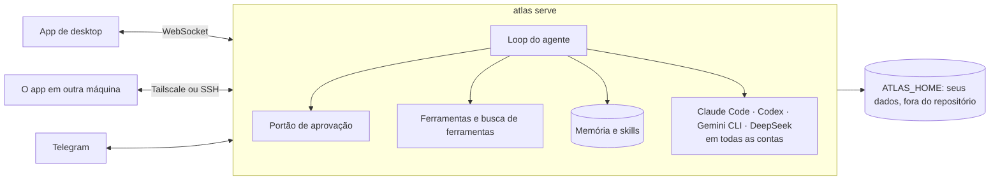

<p align="center">
  <picture>
    <source media="(prefers-color-scheme: dark)" srcset="docs/assets/logo-dark.png">
    
  </picture>
</p>

<h1 align="center">Atlas</h1>

<p align="center">
  <strong>O seu agente pessoal, e um só app para todos os agentes de código que você usa:<br>
  Claude Code, Codex, Gemini CLI e DeepSeek, em todas as contas, em todas as máquinas.</strong>
</p>

<p align="center">
  <a href="https://github.com/marqueskaio/atlas/actions/workflows/ci.yml"></a>
  <a href="LICENSE"></a>
  
  
</p>

<p align="center">
  <a href="README.md">English</a> · <b>Português</b> · <a href="README.es.md">Español</a> · <a href="README.zh-CN.md">中文</a>
</p>

---

O Atlas é um agente pessoal de código aberto, com app para desktop. Coloque uma chave de API e você
tem um assistente que guarda uma memória que você consegue ler, escreve as próprias skills conforme
aprende como você trabalha, roda rotinas agendadas e conversa com você pelo Telegram.

E é nele que moram os seus agentes de código. Rode o Claude Code na sua conta pessoal e o Codex na
da empresa, lado a lado. Quando um bate o limite do plano, a sessão segue na próxima conta, ou em
outro harness, sem perder o fio. Abra o Atlas do seu home lab, do seu VPS ou do PC do escritório
na mesma janela. Tudo o que ele sabe sobre você fica numa pasta que é sua.

## Todos os agentes de código, todas as contas, um só app

Claude Code, Codex, Gemini CLI e o harness da DeepSeek são **executores**: o Atlas roda a cópia que
você instalou, com as suas configurações, as instruções do seu projeto e o seu próprio login, e
mostra todas as sessões deles, onde quer que tenham começado.

- **Várias contas ao mesmo tempo.** Pessoal, empresa A, empresa B: cada conta na sua pasta, com as
  suas configurações, servidores MCP, plugins e histórico, para o trabalho nunca se misturar. Todas
  rodam ao mesmo tempo, e cada pasta de projeto começa na conta que você escolheu para ela.
- **Troque de conta no meio da conversa.** Acabou o crédito numa? A sessão segue em outra conta
  com tudo o que tinha.
- **Bateu o limite, segue em frente.** Quando uma conta chega no limite do plano, a próxima com
  login assume, na ordem que você definiu. Ligado de fábrica.
- **Uma rota para cada sessão.** Escolha quais contas e harnesses uma sessão pode usar e em que
  ordem, misturando harnesses:

  ```
  Claude Code · pessoal  →  Claude Code · empresa  →  Codex · principal
  ```

  No mesmo harness, a própria sessão muda de conta. Entre harnesses, o próximo começa com uma
  passagem de bastão: a tarefa, a última instrução, os passos por fazer, os arquivos mudados e o
  que aconteceu até ali, montada sem nenhuma chamada de modelo.
- **Veja o uso de cada plano.** A janela de cinco horas, a semana, a cota de cada modelo, de todas
  as contas, como o `/usage` do próprio harness mostra, lido sem gastar um token.
- **Retome qualquer sessão.** A que você começou num terminal ou no editor aparece na lista. Se ela
  ainda estiver aberta lá, o Atlas avisa e oferece continuar numa cópia.
- **Nada se perde.** Uma permissão ou uma pergunta de um executor espera por você sem prazo, no app
  ou no celular pelo Telegram. Ou deixe o Atlas responder: o revisor de segurança dele cuida das
  permissões e o modelo da conversa das perguntas, e o que ele não tiver certeza ainda chega a você.
- **O Atlas também passa trabalho para eles.** Peça em palavras e o Atlas delega ao executor certo,
  na conta que você disser, com uma rota própria (`claude-code@empresa`, depois `codex`), acompanha
  e traz o resultado.

## Todas as máquinas, um só app

Instale o Atlas no PC do escritório, num home lab ou no VPS da empresa, e abra pelo app do seu
notebook. O Atlas de lá faz o trabalho, com os arquivos, as chaves e as aprovações daquela máquina;
o app é só a janela.

- **Tailscale ou SSH.** Cole um código de conexão pelo Tailscale, sem porta para abrir e sem
  certificado para configurar, ou chegue a um servidor por um túnel SSH com as chaves que você já
  tem.
- **Sempre ligado.** Uma casa pode rodar como serviço que sobe com o computador, então as rotinas
  rodam com o app fechado e toda janela vê as mesmas conversas.
- **Um terminal em cada máquina**, no painel lateral, onde quer que o app esteja.
- **Casas separadas** mantêm trabalho e vida pessoal à parte na mesma máquina, cada uma com a sua
  memória, as suas chaves e as suas conversas.

## Por que o Atlas

- **O harness é enxuto; quem trabalha é o modelo.** O Atlas melhora toda vez que os modelos
  melhoram. Poucas ferramentas ficam sempre ligadas e o resto é achado por busca, então cada chamada
  ao modelo fica pequena e focada.
- **A memória é texto puro.** O seu perfil e as anotações do agente são arquivos que você abre,
  edita e versiona. Nenhum banco vetorial escondido decidindo o que você disse.
- **Seguro por construção.** Todo comando passa por um portão de aprovação. Algumas coisas nunca
  rodam, em modo nenhum. Tudo o que sai da sua máquina em seu nome, como fazer merge de um pull
  request ou mandar um e-mail, sempre pergunta antes.
- **Seu.** Sem conta, sem telemetria, sem nuvem nossa. Use o provedor de modelos que preferir, e o
  login dos seus próprios agentes de código, que o Atlas nunca toca.

## Ele melhora enquanto você trabalha

A cada tantas mensagens, uma cópia do agente relê a conversa em segundo plano e guarda o que ela
ensinou, para você nunca precisar corrigir a mesma coisa duas vezes:

- **Quem você é** vai para o seu perfil, e **fatos sobre o seu ambiente** (manias de ferramentas,
  caminhos, convenções) para as anotações do agente.
- **Como fazer um tipo de tarefa** vira skill. Quando você corrige o estilo ou o jeito de
  trabalhar dele, quando aparece uma correção ou um contorno, ou quando uma skill se mostra
  errada, ele ajusta a skill que cobre aquilo, e só cria uma nova quando nenhuma cobre.
- **Ele ignora o ruído:** um programa que faltava, uma tarefa avulsa, um erro que sumiu sozinho.

Ele não consegue estragar nada às escondidas. Fatos novos entram na hora, mas tudo o que
substituiria ou apagaria uma memória espera como proposta para você aprovar. Ele nunca apaga uma
skill, toda mudança guarda a versão anterior (`atlas skills revert` traz de volta), e as skills
que ele criou e ficaram 30 dias sem uso são arquivadas, nunca as suas.

## O que ele faz

| | |
|---|---|
| 🧠 **Memória que você lê** | Um perfil seu e as anotações do próprio agente, guardados como texto dentro de um limite fixo. Abra, edite, ou pergunte ao Atlas o que ele sabe. |
| 🛠️ **Skills que ele mesmo escreve** | Quando o Atlas aprende como algo é feito, salva uma skill, com versões e desfazer. Já vem com skills para GitHub, Gmail e Google Agenda. |
| 🤝 **Executores e subagentes** | Claude Code, Codex, Gemini CLI e DeepSeek em todas as suas contas, com rotas e troca automática de conta. Subagentes dividem trabalhos grandes em paralelo. |
| ⏰ **Rotinas** | Prompts e comandos agendados, escritos em palavras ("every weekday at 9") ou em cron. |
| 🤖 **Bots** | Agentes com nome, cada um com sua missão, memória, skills e rotinas, ao lado do principal. Eles conversam entre si. |
| 📱 **Telegram** | Fale com o Atlas pelo celular, e responda aos seus executores por ele. Só entra quem você parear. |
| 🎙️ **Voz** | Mande áudio e o Atlas lê, dite na caixa, receba respostas em áudio quando pedir, ou converse ao vivo. Um plugin oficial, com a sua chave da OpenAI. |
| 🌐 **Um navegador só dele** | O Atlas comanda o próprio Chrome, e você pode assumir a qualquer momento. |
| 🖥️ **Terminal e prévias** | Um painel lateral com um terminal na máquina onde o Atlas roda, e prévias de arquivos, páginas locais e do que o agente constrói. |
| 🔐 **Portão de aprovação e cofre** | Comandos perigosos perguntam, os piores nunca rodam, um modelo revisor lê os comandos sinalizados e um modo automático deixa você passar o volante. As chaves de API ficam num cofre criptografado. |
| 🧩 **Plugins** | Acrescente skills, comandos, agentes, hooks, monitores, servidores MCP, ferramentas, canais e executores. Os hooks usam os eventos e o JSON do Claude Code. |
| 🌍 **Várias máquinas, várias casas** | Um só app alcança o Atlas nos seus outros computadores por Tailscale ou SSH. Casas separadas mantêm trabalho e vida pessoal à parte. |
| 📦 **Backups e gastos** | Um zip com os seus dados (nunca o cofre) e uma restauração que confere tudo antes. Gastos por dia, modelo e finalidade. |

## Instalação

**Windows**, no PowerShell:

```powershell
irm https://atlasv4.com/install.ps1 | iex
```

**macOS e Linux**, num terminal:

```bash
curl -fsSL https://atlasv4.com/install.sh | bash
```

O instalador traz tudo o que o Atlas precisa (Python, Node e ferramentas próprios, conferidos contra
hashes fixados), compila o app de desktop e abre. O app pede a chave de API de um provedor de
modelos, e você já está conversando com o Atlas. Ligue o Claude Code, o Codex, o Gemini CLI ou o
harness da DeepSeek em Plugins, nas Configurações, e cada um que você tiver instalado aparece na aba
Executores. Para atualizar, rode a mesma linha de novo; o `atlas update` também atualiza, e volta
para onde estava se algum passo falhar.

**Num container:** o começo do [docker-compose.yml](docker-compose.yml) tem os três comandos: subir,
guardar uma chave de API e pegar o token de que o app de desktop precisa.

### Provedores de modelos

OpenAI, Anthropic, Google Gemini e OpenRouter com chave de API, e modelos locais pelo Ollama ou
pelo vLLM. Cada conversa pode trocar de modelo.

## Como funciona



O Atlas tem o próprio loop de agente, sem framework de agentes por baixo: ele fala com o SDK
oficial de cada provedor. O servidor é a única fonte da verdade, e o app de desktop, o Telegram e
as outras máquinas são clientes dele. Tudo sobre você (perfil, memória, conversas, configurações,
cofre) fica no `ATLAS_HOME`, nunca no código. As contas dos seus executores ficam nas pastas delas,
com o login feito pelo próprio harness.

## Documentação

Os documentos estão em inglês. A documentação fica em [src/atlas/docs/pages/](src/atlas/docs/pages/), e cada Atlas instalado lê a
da sua versão com `atlas docs`: o próprio Atlas também a lê ali antes de responder uma pergunta
sobre si.

- [O que é o Atlas](src/atlas/docs/pages/index.md) e [como instalar](src/atlas/docs/pages/install.md)
- [Agentes de código e contas](src/atlas/docs/pages/guides/coding-agents.md) e [várias máquinas](src/atlas/docs/pages/guides/machines.md)
- [Memória](src/atlas/docs/pages/guides/memory.md): o que o Atlas lembra, como, e como mudar
- [Revisão em segundo plano](src/atlas/docs/pages/guides/background-review.md): como o Atlas aprende com uma conversa
- [Bots](src/atlas/docs/pages/guides/bots.md): criar um bot e conversar com ele
- [O portão de aprovação](src/atlas/docs/pages/guides/approval-gate.md): o que pergunta, o que nunca roda, e o modo automático
- [Comandos](src/atlas/docs/pages/reference/commands.md), [configurações](src/atlas/docs/pages/reference/settings.md) e [ferramentas](src/atlas/docs/pages/reference/tools.md): a referência, as duas primeiras escritas a partir do código
- [Plugins](src/atlas/docs/pages/extending/plugins.md): escrever um plugin

Para quem trabalha no código:

- [Arquitetura](docs/ARCHITECTURE.md): as decisões e as regras que o código segue
- [Glossário](docs/GLOSSARY.md): as palavras que o Atlas usa

## Situação

O Atlas é novo e anda rápido. É usado todo dia, e uma suíte grande de testes roda a cada mudança:
testes de unidade, o app de desktop de verdade de ponta a ponta, os instaladores no Windows e no
Linux, e a imagem do container. Espere arestas e mudanças entre versões. O plano está no
[ROADMAP.md](ROADMAP.md).

## Contribuindo

Issues e pull requests são bem-vindos. Leia o [AGENTS.md](AGENTS.md) para saber como trabalhar no
código, e o [docs/ARCHITECTURE.md](docs/ARCHITECTURE.md) antes de escrever qualquer linha: o CI
cobra as regras dele.

```bash
uv sync                 # instala (o uv cuida do Python 3.13)
uv run pytest           # testes
uv run atlas serve      # o servidor, em 127.0.0.1:18790
cd apps/desktop && npm ci && npm run dev   # o app, a partir do código
```

## Licença

[MIT](LICENSE). Alguns arquivos trazem regras e casos de teste de outros projetos MIT; cada um diz
isso no próprio cabeçalho, e o texto da licença está em [LICENSES/](LICENSES/).
